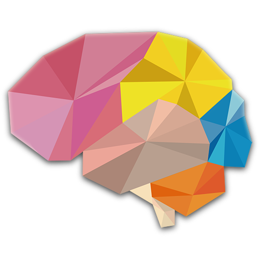
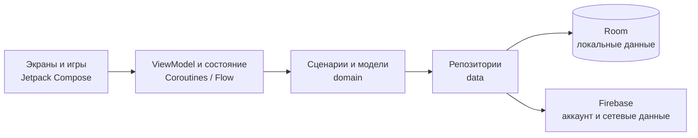

<div align="center">



# BrainStorm

**Мини-игры на реакцию и память для Android**


[Скриншоты](#скриншоты) · [Мини-игры](#мини-игры) · [Возможности](#возможности) · [Архитектура](#архитектура) · [Сборка](#сборка) · [Статус](#статус)

</div>

Мой самостоятельный Android-проект, вдохновлённый BrainWars: две реализованные мини-игры, игровой интерфейс, профиль, друзья, чаты и статистика. На Kotlin и Jetpack Compose собраны экраны и анимации, локальное хранение через Room и сетевые сценарии на Firebase.

## Скриншоты

<table>
  <tr>
    <th width="33%">Главный экран</th>
    <th width="33%">Path To Safety</th>
    <th width="33%">Результат игры</th>
  </tr>
  <tr>
    <td align="center"><a href="https://github.com/user-attachments/assets/12cf9ab3-ba1a-431a-b17b-755003238be6"></a></td>
    <td align="center"><a href="https://github.com/user-attachments/assets/32d5632b-19d6-40d2-bc40-5aea2431990d"></a></td>
    <td align="center"><a href="https://github.com/user-attachments/assets/a1819905-1239-4447-895b-7d8d2dcd30e9"></a></td>
  </tr>
</table>

<details>
<summary>Мини-игры и подготовка матча</summary>

<table>
  <tr>
    <th width="50%">Каталог мини-игр</th>
    <th width="50%">Правила Path To Safety</th>
  </tr>
  <tr>
    <td align="center"><a href="https://github.com/user-attachments/assets/4317e1bc-702c-490f-86bb-ef3905a31a90"></a></td>
    <td align="center"><a href="https://github.com/user-attachments/assets/11b935ba-3f84-482f-ae6a-d3724e208e15"></a></td>
  </tr>
  <tr>
    <th width="50%">Запоминание поля</th>
    <th width="50%">Ожидание соперника</th>
  </tr>
  <tr>
    <td align="center"><a href="https://github.com/user-attachments/assets/d8c463ce-556f-42ee-bc29-9849095e2940"></a></td>
    <td align="center"><a href="https://github.com/user-attachments/assets/3c9d0615-748d-40b8-80f4-b9559ba192d8"></a></td>
  </tr>
  <tr>
    <th colspan="2">Подготовка матча</th>
  </tr>
  <tr>
    <td colspan="2" align="center"><a href="https://github.com/user-attachments/assets/cf65e8b2-b9d4-4c9f-bcad-468de13010aa"></a></td>
  </tr>
</table>

</details>

<details>
<summary>Профиль, друзья и сообщения</summary>

<table>
  <tr>
    <th width="50%">Профиль</th>
    <th width="50%">Друзья</th>
  </tr>
  <tr>
    <td align="center"><a href="https://github.com/user-attachments/assets/451ac2d6-6bcb-4bc4-bb40-3ba1d6f14ee2"></a></td>
    <td align="center"><a href="https://github.com/user-attachments/assets/aa5495ee-2208-4de4-a394-47af8f7c437f"></a></td>
  </tr>
  <tr>
    <th width="50%">Карточка статистики</th>
    <th width="50%">Личные сообщения</th>
  </tr>
  <tr>
    <td align="center"><a href="https://github.com/user-attachments/assets/2171b1ee-deaa-4792-a4fe-bd09f7c8e5c7"></a></td>
    <td align="center"><a href="https://github.com/user-attachments/assets/4aaa0e11-4b75-4768-8d96-893c46f2c26a"></a></td>
  </tr>
</table>

</details>

<details>
<summary>Статистика и достижения</summary>

<table>
  <tr>
    <th width="50%">Статистика игр</th>
    <th width="50%">Статистика матчей</th>
  </tr>
  <tr>
    <td align="center"><a href="https://github.com/user-attachments/assets/57e42d1e-7b39-4e75-a45a-350eb3bb14e5"></a></td>
    <td align="center"><a href="https://github.com/user-attachments/assets/4bd145c2-2823-4a4f-8a4a-f2f4cfa12fb4"></a></td>
  </tr>
  <tr>
    <th width="50%">Раздел достижений</th>
    <th width="50%">Карточка достижения</th>
  </tr>
  <tr>
    <td align="center"><a href="https://github.com/user-attachments/assets/d4a70380-1a73-4764-bbb6-008e0521bc15"></a></td>
    <td align="center"><a href="https://github.com/user-attachments/assets/3b71ec8f-8fae-4cd5-8c29-7d561b2b0423"></a></td>
  </tr>
</table>

</details>

<details>
<summary>Заставки и загрузка</summary>

<table>
  <tr>
    <th width="50%">Заставка KSU Games</th>
    <th width="50%">Заставка BrainStorm</th>
  </tr>
  <tr>
    <td align="center"><a href="https://github.com/user-attachments/assets/6f02972e-b8c2-49ee-b596-873671a3864d"></a></td>
    <td align="center"><a href="https://github.com/user-attachments/assets/ee1f81f5-df43-4396-aba5-01919d8db204"></a></td>
  </tr>
  <tr>
    <th width="50%">Загрузка статистики</th>
    <th width="50%">Вариант загрузки</th>
  </tr>
  <tr>
    <td align="center"><a href="https://github.com/user-attachments/assets/1402eb1b-dd2d-4a75-8c71-db30cc58afe0"></a></td>
    <td align="center"><a href="https://github.com/user-attachments/assets/2cb0459a-e3f5-4652-9716-6c9b5985097f"></a></td>
  </tr>
</table>

</details>

## Мини-игры

| Игра | Задача | Что реализовано |
| --- | --- | --- |
| **Flick Master** | Провести пальцем по направлению синей стрелки или против направления красной | Смена заданий, таймер, проверка ответов, очки и точность |
| **Path To Safety** | Запомнить препятствия на поле 4×4 и провести безопасный маршрут между флагами | Этап запоминания, построение пути, проверка, таймер и результаты |

Остальные семь игр в каталоге представлены экранами и ресурсами; их игровые механики остались заготовками.

## Возможности

- Регистрация, вход и восстановление пароля по электронной почте через Firebase Authentication.
- Профиль, заявки в друзья, список друзей и личные сообщения через Cloud Firestore.
- Результаты мини-игр и статистика матчей.
- Локальное хранение настроек, профиля и игровых данных в Room.
- Навигация между разделами, анимации переходов и игровых состояний.

Сетевой матч реализован как экспериментальный контур: создание и поиск сессии, ожидание соперника и передача счёта через Firestore. Подключены два игровых раунда; третий остался незавершённым.

## Архитектура



Код разделён на [интерфейс](app/src/main/java/com/kuvalin/brainstorm/presentation), [модели и сценарии](app/src/main/java/com/kuvalin/brainstorm/domain) и [работу с данными](app/src/main/java/com/kuvalin/brainstorm/data). Navigation Compose связывает основные и вложенные экраны, Dagger 2 собирает зависимости. Для состояния используются ViewModel, Compose State и Flow.

## Сборка

Приложение рассчитано на **Android 8.0 и новее**. Для сборки нужны Android Studio, Android SDK 34 и JDK 17 для Gradle. В проекте отдельно задана Java toolchain 8 — должен быть доступен и JDK 8 для компиляции.

<details>
<summary>Сборка и подключение Firebase</summary>

1. Клонировать репозиторий и открыть его корень в Android Studio.
2. Выбрать JDK 17 в настройках Gradle JDK, установить SDK 34 и предоставить JDK 8 как toolchain.
3. Дождаться синхронизации Gradle и выбрать устройство или эмулятор с API 26+.
4. Для собственных сетевых сценариев зарегистрировать Android-приложение `com.kuvalin.brainstorm` в Firebase и локально заменить `app/google-services.json` своей конфигурацией. Включить вход по email/password, создать Cloud Firestore и настроить правила доступа.
5. Запустить конфигурацию `app`.

Сборка debug APK из PowerShell:

```powershell
git clone https://github.com/Vkuvalin/BrainStorm.git
cd BrainStorm
.\gradlew.bat :app:assembleDebug
```

APK: `app/build/outputs/apk/debug/app-debug.apk`.

Исходная конфигурация: Gradle 8.0.2, Android Gradle Plugin 8.1.2, Kotlin 1.8.10, compile/target SDK 34. Свежая сборка и доступность исторического Firebase-проекта в этом проходе не проверялись.

</details>

## Статус

Разработка остановлена. Сохранены две игровые механики, интерфейс и экспериментальные сетевые сценарии. Остальные мини-игры, часть настроек и достижений остались незавершёнными.

Некоммерческий личный проект, вдохновлённый BrainWars; с правообладателями оригинальной игры не связан.
